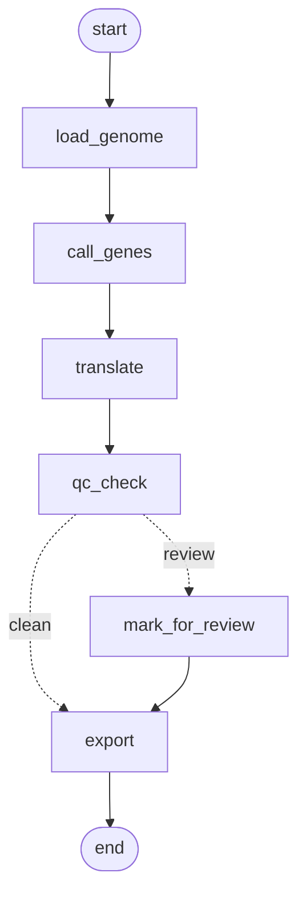

# GeneWeaver v3: agentic prokaryotic genome annotation

An LLM-era successor to **AGMIAL** (Bryson et al., *Nucleic Acids Research* 34(12):3533–3545, 2006).
Like AGMIAL, annotation is split between two managers, rebuilt here as LangGraph agents:

| Agent | AGMIAL ancestor | Job |
|---|---|---|
| **CAM** (Contig Analysis Manager) | CAM | Genome → gene models → protein sequences |
| **PAM** (Protein Analysis Manager) | PAM | Proteins → product name, EC number, GO terms, with evidence |

The two agents share state. PAM can send a suspect gene model back to CAM
(e.g. a protein whose N-terminus disagrees with its homologues), which is the
modern equivalent of AGMIAL's CAM ⇄ PAM synchronisation.

## Status

- [x] **CAM v0**: gene calling (Pyrodigal), translation with independent Biopython cross-check, rule-based QC, conditional routing of suspect genes, FASTA/GFF3/TSV export, SQLite checkpointing
- [x] **Evaluation v0**: gene-call accuracy against RefSeq (exact match, start-codon errors, missed, extra)
- [ ] PAM agent (homology, domains, GO/EC via MCP tool server)
- [ ] CAM ⇄ PAM feedback loop
- [ ] Function evaluation against Swiss-Prot

## CAM graph



`mark_for_review` is where flagged genes will be handed to PAM.

## Quick start

The project is managed with [uv](https://docs.astral.sh/uv/) (Python 3.12).

```bash
uv sync

# 1. Download L. sakei 23K (the genome AGMIAL annotated) + its RefSeq annotation
uv run scripts/download_data.py

# 2. Run CAM and evaluate against RefSeq
uv run scripts/run_cam.py --genome data/raw/lsakei_23k.fna --ref data/raw/lsakei_23k.gff3

# 3. Tests
uv run pytest -q
```

E. coli K-12 as a second genome:

```bash
uv run scripts/download_data.py --accession NC_000913.3 --name ecoli_k12
uv run scripts/run_cam.py --genome data/raw/ecoli_k12.fna --ref data/raw/ecoli_k12.gff3
```

Outputs go to `results/<name>/`: `proteins.faa`, `genes.gff3`, `qc_table.tsv`,
`cam_eval.json`, `run_log.txt`. Every graph step is checkpointed in
`results/checkpoints.sqlite`.

## Evaluation method

A predicted CDS and a reference CDS are the **same gene** if they share contig,
strand and stop coordinate (the standard rule used in the Prodigal paper).
If the start also matches it is **exact**; otherwise it is a **start error**.
Reference pseudogenes (`pseudo=true`) are excluded and counted separately.

Start errors matter because they are exactly what PAM's homology evidence can
detect and send back to CAM. This motivates the CAM ⇄ PAM loop.

## Layout

```
src/geneweaver/cam/          CAM agent (state, nodes, graph)
src/geneweaver/evaluation/   comparison against reference annotations
scripts/                     data download, run entry points
tests/                       pytest suite (synthetic genome, no internet needed)
docs/                        decisions, problems and meeting logs
data/raw/                    downloaded genomes (git-ignored)
results/                     run outputs (git-ignored)
```
